# Previsão de Churn — Ciência de Dados

[](https://www.python.org/)
[](https://jupyter.org/)
[](https://scikit-learn.org/)
[](#resultados)
[](LICENSE)

Projeto completo de **ciência de dados / machine learning** para prever a evasão
(*churn*) de clientes de uma empresa de telecomunicações — da análise exploratória
à recomendação de negócio.

- **Dataset:** [IBM Telco Customer Churn](https://github.com/IBM/telco-customer-churn-on-icp4d) — 7.043 clientes, 21 atributos
- **Problema:** classificação binária (`Churn`: Yes/No), classe desbalanceada (**26,5%** de churn)
- **Stack:** Python 3.12 · pandas · scikit-learn · seaborn/matplotlib · Jupyter

---

## Resultados

**Modelo final:** Random Forest (`n_estimators=800, max_depth=8, min_samples_leaf=3`),
avaliado em **1.407 clientes nunca vistos** (teste 20% estratificado).

| Métrica (conjunto de teste) | Valor |
|---|---|
| **ROC-AUC** | **0,835** |
| PR-AUC | 0,641 |
| Recall (limiar 0,50) | 0,794 |
| Precisão (limiar 0,50) | 0,509 |
| F1 (limiar 0,50) | 0,620 |
| Acurácia (limiar 0,50) | 0,741 |

<p align="center">
  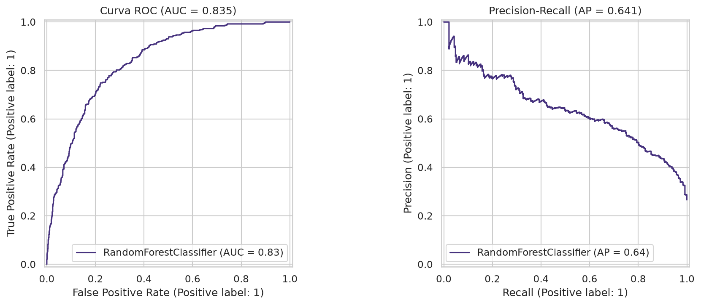
  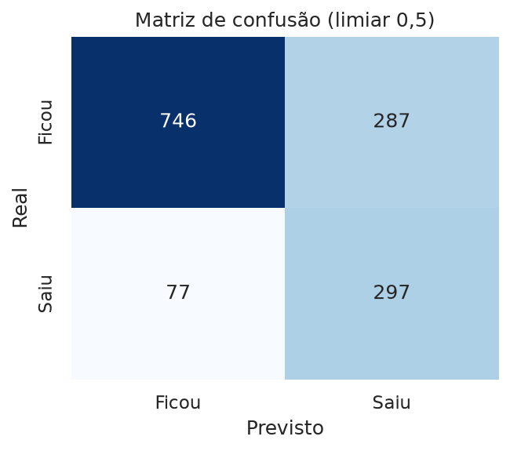
</p>
<p align="center"><i>Esquerda: curvas ROC e Precision-Recall. Direita: matriz de confusão — o modelo capturou 79% dos clientes que realmente saíram.</i></p>

### Comparação dos modelos (validação cruzada 5-fold, ROC-AUC)

| Modelo | ROC-AUC (CV) |
|---|---|
| Dummy (baseline ingênuo) | 0,500 |
| Regressão Logística (balanceada) | 0,8467 |
| Gradient Boosting | 0,8477 |
| **Random Forest (ajustado)** | **0,8492** |

<p align="center">
  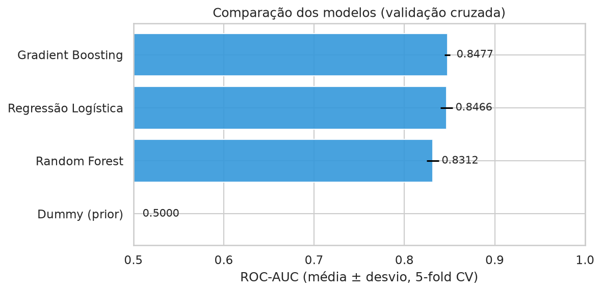
</p>

> A busca de hiperparâmetros (`GridSearchCV`) subiu o Random Forest de 0,831 para
> **0,849** — acima das demais técnicas, com diferença pequena e estável entre folds.

---

## O que a análise revelou

**26,5% dos clientes saíram** — classe desbalanceada, tratada com
`class_weight="balanced"`, ROC-AUC e análise de limiar (não acurácia pura).

<p align="center">
  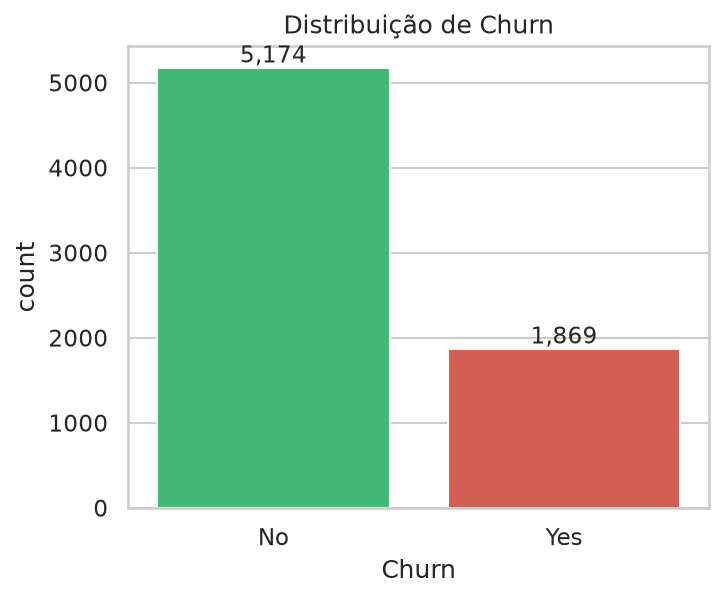
  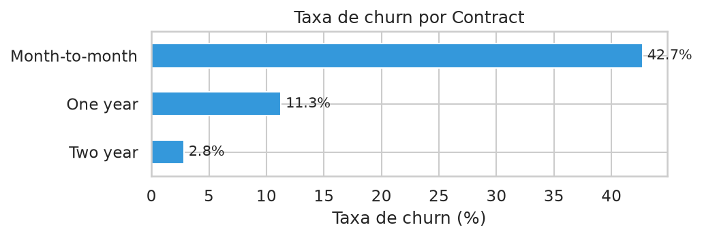
</p>
<p align="center"><i>Distribuição da variável alvo e taxa de churn por tipo de contrato.</i></p>

### Fatores de risco (churn médio por grupo)

| Fator | Churn | Comparação |
|---|---|---|
| Contrato **mês a mês** | **42,7%** | contrato de 2 anos: 2,8% |
| Internet por **fibra óptica** | **41,9%** | DSL: 19,0% · sem internet: 7,4% |
| Pagamento por **boleto eletrônico** | **45,3%** | débito automático: 15–17% |
| **Sem** TechSupport | **41,6%** | com TechSupport: 15,2% |
| **Sem** OnlineSecurity | **41,8%** | com OnlineSecurity: 14,6% |

### Comportamento dos clientes

- **Tempo de casa (tenure):** mediana de **10 meses** entre quem saiu vs. **38 meses** entre quem ficou — a janela crítica são os **primeiros 12 meses**.
- **Gasto mensal:** churners pagam em média **US$ 74,4** vs. **US$ 61,3** (carregados por fibra cara).
- **Serviços adicionais** (suporte, backup, segurança) funcionam como *âncoras* de retenção.

<p align="center">
  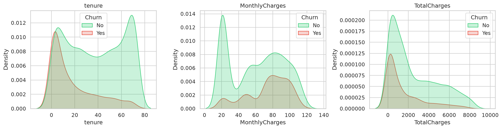
  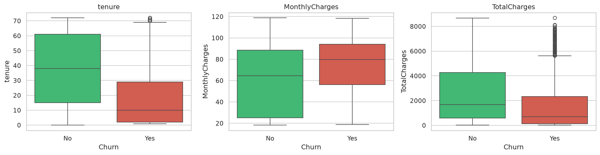
</p>
<p align="center"><i>Distribuição de tenure, MonthlyCharges e TotalCharges separadas por churn.</i></p>

<p align="center">
  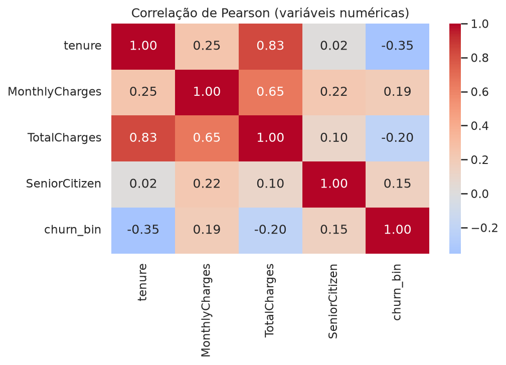
</p>
<p align="center"><i>Correlação de Pearson entre as variáveis numéricas e o alvo.</i></p>

---

## Limiar de corte: o 0,50 padrão não é regra

Em churn, errar um cliente que sai custa mais caro que contactar um que ficaria.
O gráfico abaixo mostra o *trade-off* precisão × recall:

<p align="center">
  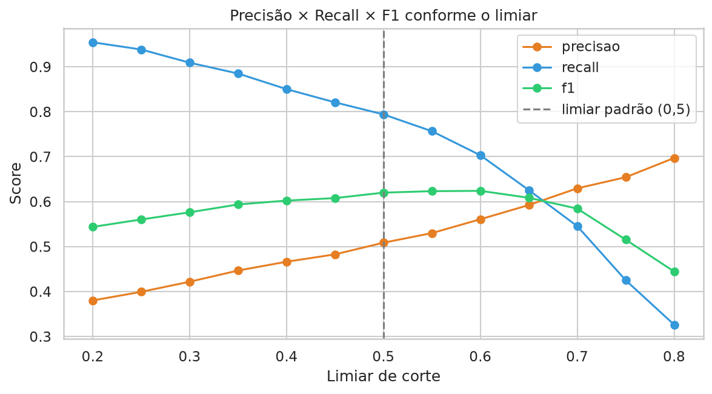
</p>

| Limiar | Precisão | Recall | F1 |
|---|---|---|---|
| 0,40 | 0,466 | 0,850 | 0,602 |
| **0,50** | 0,509 | **0,794** | 0,620 |
| **0,60** | 0,561 | 0,703 | **0,624** ← melhor F1 |
| 0,70 | 0,630 | 0,546 | 0,585 |

<p align="center">
  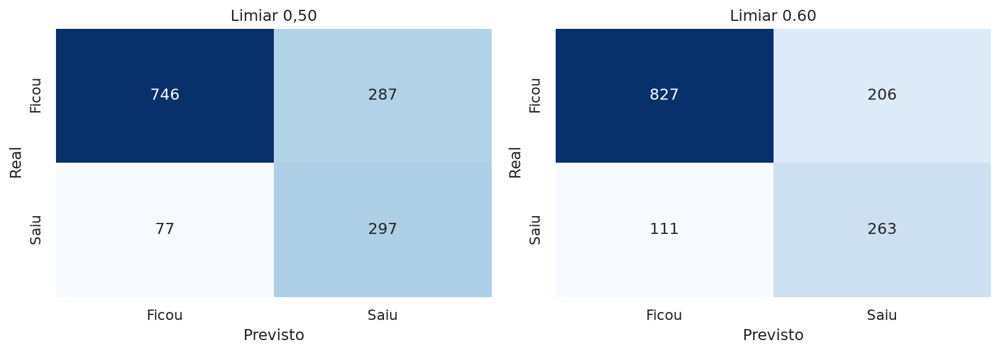
</p>
<p align="center"><i>Matrizes de confusão comparando limiar 0,50 × 0,60.</i></p>

---

## As features que mais importam

Importância por **permutação** (queda média de ROC-AUC ao embaralhar a variável):

<p align="center">
  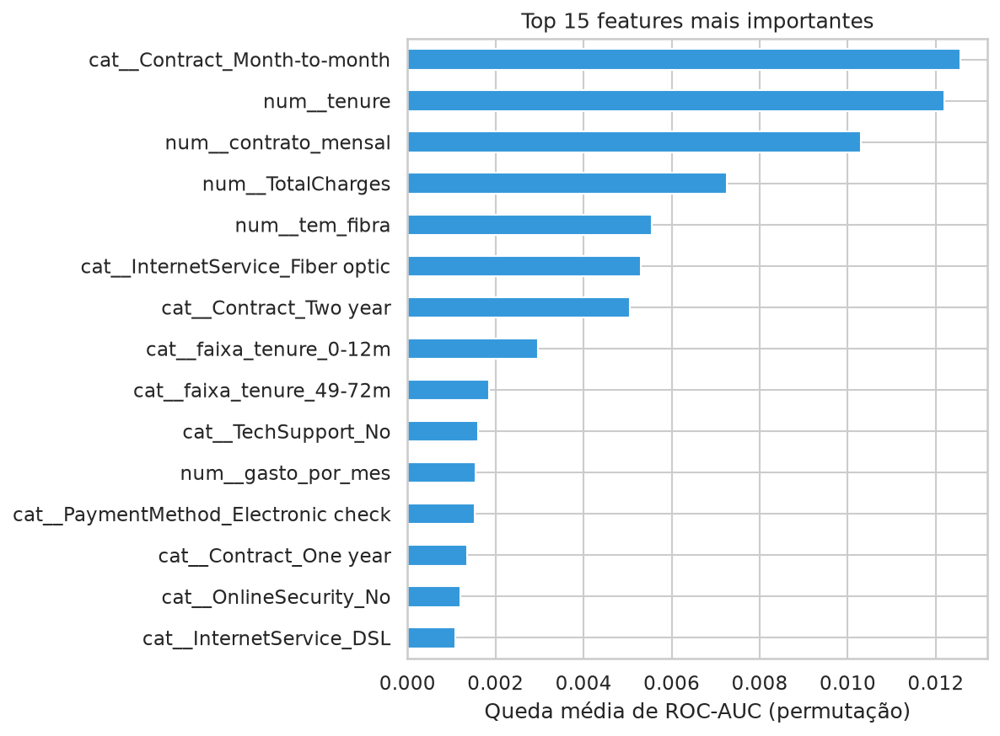
</p>

- `Contract_Month-to-month` e `tenure` dominam — **tipo de contrato e tempo de casa** explicam a maior parte do churn.
- `TotalCharges`, `tem_fibra` e `InternetService_Fiber optic` aparecem logo atrás.
- O modelo confirma quantitativamente o que a EDA mostrou qualitativamente.

---

## Recomendações de negócio

1. **Onboarding reforçado nos 6–12 primeiros meses** — é onde está o churn (mediana de 10 meses).
2. **Migração para contrato anual** com desconto para clientes de risco (42,7% vs 2,8%).
3. **Pacote de TechSupport + OnlineSecurity** em teste gratuito por 3 meses (quase 3× menos churn).
4. **Incentivo ao débito automático** (15% vs 45% no boleto eletrônico).
5. **Score mensal de churn** por cliente para a retenção contatar proativamente o top-N.

---

## Estrutura do projeto

```
churn-prediction/
├── README.md
├── LICENSE                        # MIT
├── requirements.txt
├── .gitignore
├── data/
│   ├── raw/Telco-Customer-Churn.csv
│   └── processed/                 # splits train/test (gerado pelo nb 02)
├── notebooks/
│   ├── 01_eda.ipynb                        # análise exploratória
│   ├── 02_preprocessamento_feature_engineering.ipynb
│   ├── 03_modelagem.ipynb                  # CV + GridSearch
│   └── 04_avaliacao_interpretacao.ipynb    # teste, limiar, importância
├── models/
│   ├── preprocessor.joblib
│   ├── modelo_churn.joblib
│   └── resumo_modelagem.json
└── reports/figures/               # 11 gráficos deste README
```

## Como executar

```bash
git clone https://github.com/thomaz2512/churn-prediction.git
cd churn-prediction
python3 -m venv --system-site-packages .venv
source .venv/bin/activate
pip install -r requirements.txt
jupyter notebook notebooks/
```

Execute os notebooks **na ordem** (01 → 04) — ou use *Kernel → Restart & Run All*.

## Pipeline

1. **EDA** — qualidade dos dados, distribuição do alvo, churn por categoria,
   distribuições e correlações.
2. **Pré-processamento** — limpeza (11 nulos em `TotalCharges`), 7 features novas
   (`faixa_tenure`, `qtd_servicos`, `gasto_por_mes`, flags…), split estratificado
   80/20 e `ColumnTransformer` (imputação + scaler + one-hot).
3. **Modelagem** — baseline Dummy, Regressão Logística, Random Forest e
   Gradient Boosting; `GridSearchCV` com ROC-AUC; modelo salvo em `models/`.
4. **Avaliação** — métricas no teste, curvas ROC/PR, análise de limiar,
   permutation importance e recomendações de negócio.

## Licença

Distribuído sob a licença [MIT](LICENSE).

Dataset: [IBM Telco Customer Churn](https://github.com/IBM/telco-customer-churn-on-icp4d) (domínio público).
